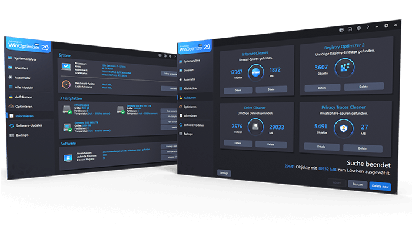
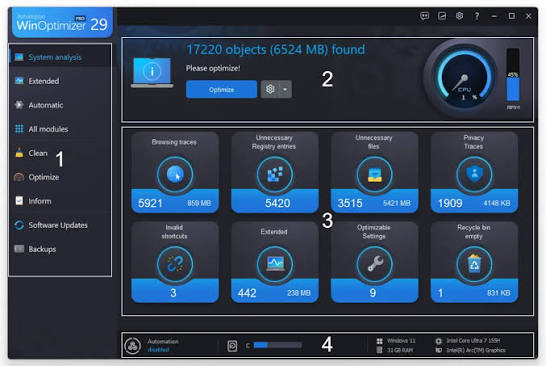

# Ashampoo WinOptimizer for Practical Windows System Maintenance

[](https://winoptimizer-29.github.io/Ashampoo-WinOptimizer/)

WinOptimizer 29 brings cleaning, system inspection, and maintenance controls into a Windows desktop interface.
This guide organizes a review around observable changes, selected tasks, and repeatable checks.

Ashampoo WinOptimizer is the commercial application discussed here.
The linked source files belong to a partial BleachBit reference snapshot and illustrate a separate open-source cleaner.

## Features

The product groups tools for cleaning, optimization, and system information.
Its manual also describes startup inspection, privacy controls, and individual maintenance modules.

| Review area | Useful question | Evidence to retain |
| --- | --- | --- |
| Disk cleanup | Which selected items account for the estimated space? | Categories and scan totals |
| Browser traces | Which browser data should remain available? | Selected categories and exclusions |
| Startup entries | Which applications need to launch automatically? | Entry names and initial state |
| Privacy settings | Which Windows behavior should change? | Setting names and previous values |
| System information | Which machine is being assessed? | OS version and storage details |

Treat each scan as a proposal to review.
A detected item does not by itself establish a performance problem.



Use a small scope for the first maintenance pass.
Record the starting conditions before comparing results.

The BleachBit interface reference is [app-menu.ui](share/app-menu.ui).
Its menu actions belong to BleachBit and do not document WinOptimizer controls.

## How to use

A practical review follows the same sequence each time:

1. Record the Windows version, available disk space, and applications currently open.
2. Choose a single maintenance category.
3. Inspect its analysis results and selected items.
4. Apply only the changes intended for that pass.
5. Reopen affected applications and repeat the initial checks.

Close a browser before assessing its cache.
Retain sign-in information or site preferences when they matter to the review.

The following example uses Windows PowerShell and CIM to inspect fixed logical disks.
It reads capacity values and does not invoke WinOptimizer.

```powershell
Get-CimInstance Win32_LogicalDisk -Filter "DriveType=3" |
    Select-Object DeviceID,
        @{Name='SizeGiB';Expression={[math]::Round($_.Size / 1GB, 2)}},
        @{Name='FreeGiB';Expression={[math]::Round($_.FreeSpace / 1GB, 2)}}
```

Capture the same output after a maintenance pass.
Other applications can create temporary files during the interval, so note concurrent activity.

For startup changes, compare the same sign-in sequence before and afterward.
Keep essential background tasks in view when interpreting a shorter startup time.

## Automation / Presets

Agree on a repeatable selection before reviewing automatic maintenance.
Record which categories are included and which applications require exclusions.

A useful maintenance record contains:

- The machine and Windows build.
- The selected product modules.
- Any changed selection or exclusion.
- The observation made before the task.
- The result measured afterward.

Automatic execution deserves a stable scope.
Review a changed selection manually before relying on it for repeated maintenance.

The BleachBit reference includes [ci-linux-tests.sh](scripts/ci-linux-tests.sh).
That script belongs to upstream Linux testing rather than Windows cleanup scheduling.

Its companion [ci-linux-deps.sh](scripts/ci-linux-deps.sh) prepares CI dependencies.
These scripts provide examples of separating environment preparation from verification.

## Security

Privacy controls and file deletion address different tasks.
Review the intended outcome before selecting a module.

The WinOptimizer manual describes permanent deletion among its file operations.
Do not use a deletion operation when the intended task is recovery.

BleachBit records paths that trigger deletion warnings in [protected_path.xml](share/protected_path.xml).
This list is a warning mechanism rather than an automatic exclusion list.

The corresponding [protected_path.xsd](doc/protected_path.xsd) describes that document's structure.
Neither file supplies WinOptimizer privacy settings.

Keep an independent backup of important documents before reviewing destructive operations.
A maintenance log helps explain what changed but cannot replace the deleted data.



## Development

The source links below are references for understanding cleaner design and project maintenance.
They are not the source code of the commercial application.

BleachBit's [cleaner_markup_language.xsd](doc/cleaner_markup_language.xsd) defines its cleaner XML format.
The companion [example_cleaner.xml](doc/example_cleaner.xml) demonstrates a cleaner definition.

This Python example reads that XML using the standard library.
It prints identifiers without performing the cleaning actions described by the document.

```python
import xml.etree.ElementTree as ET

root = ET.parse("doc/example_cleaner.xml").getroot()
print("Root element:", root.tag)
print("Cleaner ID:", root.get("id"))
print("Option IDs:", [item.get("id") for item in root.findall("option")])
```

The relative path assumes the reference snapshot is the working directory.
This is an inspection example for BleachBit data, not a WinOptimizer integration.

Upstream build references show how separate operating-system environments are described:

- [Dockerfile.debian](docker/Dockerfile.debian) defines the Debian container environment.
- [Dockerfile.fedora](docker/Dockerfile.fedora) defines the Fedora container environment.
- [Dockerfile.opensuse](docker/Dockerfile.opensuse) defines the openSUSE container environment.

The container helper [inside_container.sh](docker/inside_container.sh) coordinates work inside those environments.
These Linux build definitions do not establish Windows product compatibility.

The broader dependency helper is [install-deps.sh](scripts/install-deps.sh).
The FreeBSD test workflow is documented in [test_freebsd.sh](scripts/test_freebsd.sh).

The upstream [Makefile](Makefile) collects development and packaging targets.
This partial snapshot alone does not establish that those targets can complete.

## System Requirements

Ashampoo currently lists Windows 10 and Windows 11 for WinOptimizer Pro 29.
Systems using ARM processors are excluded.

The listed minimum display resolution is 1280 by 768.
The recommended resolution is 1920 by 1080.

Full administrative rights are required.
Internet access is required for activation and recurring license verification.

Check the vendor requirements when assessing another edition or release.
The BleachBit development environments above describe a different application.

## Localization

Use the interface language consistently when recording module names.
Include the exact visible label when reporting a setting that is difficult to locate.

The BleachBit desktop integration reference is [org.bleachbit.BleachBit.desktop](org.bleachbit.BleachBit.desktop).
Its localized entries demonstrate how that separate application is presented on a Linux desktop.

The application metadata reference is [org.bleachbit.BleachBit.metainfo.xml](org.bleachbit.BleachBit.metainfo.xml).
Its identifiers and licensing fields describe BleachBit.

## Support

Use the vendor's release-specific documentation when identifying a WinOptimizer module.
Include the product version, Windows build, and selected task in a support request.

Useful official references:

- [WinOptimizer product overview](https://www.ashampoo.com/en-us/winoptimizer)
- [WinOptimizer Pro 29 manual](https://support.ashampoo.com/hc/en-us/articles/35329601852306-WinOptimizer-Pro-29-Manual)
- [Current system requirements](https://www.ashampoo.com/en-us/winoptimizer/requirements)

Keep the commercial application's license separate from the licenses of reference projects.
The presence of BleachBit files does not grant rights to redistribute WinOptimizer.

## Related Search Terms

WinOptimizer 29, Ashampoo WinOptimizer, winoptimizer pro 29, ashampoo win optimiser, ashampoo pc cleaner, windows, system-cleaner, disk-cleaner, cleanup, privacy, privacy-tools, desktop-app, gui, tweaks, powershell
